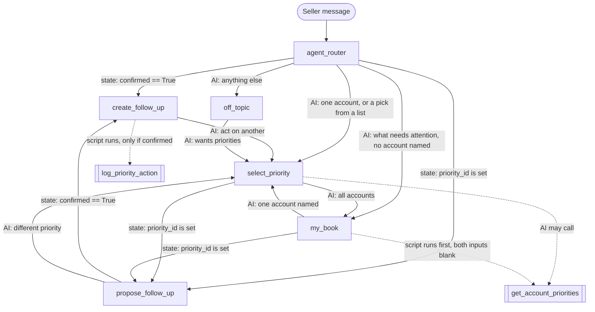

[Index](README.md) · [← Previous: Coworker first](06-demo-coworker-default.md) · [Next: Exercise 2: Build the actions →](08-exercise-build-actions.md)

# Exercise 1: Design the agent

**Time:** 45 minutes  
**Driver:** The customer lead. The group contributes; the facilitator keeps time  
**Tool:** a whiteboard or a shared doc. **No code in this exercise**  
**Output:** an Agent Spec, pseudocode and a subagent map that the customer lead approves

Design comes before code. Each step has a blank template to fill in, then a **reference answer** to compare against. Fill in the template first. Open the reference only when you're done, or stuck.

| Step | What | Time |
|---|---|---|
| 1 | Defend "why an agent" against the rule | 5 min |
| 2 | Fill in the Agent Spec | 15 min |
| 3 | Write the pseudocode | 10 min |
| 4 | Draw the subagent map | 5 min |
| 5 | List the deterministic controls and their cause | 5 min |
| | Critique with AI (optional), then approve | 5 min |

---

## Step 1: Why an agent?

Test the job against the rule from [page 4](04-architecture-coworker-first.md). It needs **at least two** to be an agent.

**Job:** turn one open account priority into a confirmed Task or Opportunity, and mark the priority Actioned.

| Test | Does the job need it? | Evidence (one line) |
|---|---|---|
| State across turns | ☐ Yes ☐ No | |
| A sequence or gate that must hold every time | ☐ Yes ☐ No | |
| Writes that follow business rules | ☐ Yes ☐ No | |
| Its own access control | ☐ Yes ☐ No | |
| A regression test suite | ☐ Yes ☐ No | |
| **Could Coworker or a skill do it instead?** | | |

<details>
<summary><strong>Reference answer</strong></summary>

| Test | Needs it? | Evidence |
|---|---|---|
| State across turns | Yes | Pick a priority, see a proposal, maybe change a detail, confirm. The chosen priority and the agreed details carry across 3 or more turns |
| A gate that must hold | Yes | No Task or Opportunity before the seller says yes. Every time, not most of the time |
| Writes with business rules | Yes | Open priorities only. One follow-up per priority. Priority marked Actioned and linked to the new record in the same transaction |
| Its own access control | Yes | Sellers get it through two permission sets. It runs as the seller, so sharing decides which accounts they see |
| A regression test suite | Yes | Apex unit tests for every rule, and 13 seller tests to re-run before each change |
| Coworker or a skill instead? | No | Coworker reviews one write but holds no rule like "Open only, never twice", and nothing fixes the order of the steps. A skill is read-only |

**Verdict:** agent. It passes 5 of 5.

</details>

---

## Step 2: Fill in the Agent Spec

### Template

| Field | Your answer |
|---|---|
| Label / API name | |
| Agent type | |
| Who uses it, and whose access it runs with | |
| Channel (how the seller reaches it) | |
| Purpose (one sentence) | |
| Subagents (name: job) | |
| Variables (name, type, default: what it holds) | |
| Actions (name, Apex class, inputs, outputs; can the AI call it?) | |
| Deterministic controls (see Step 5) | |
| Error cases (what the seller sees) | |
| Out of scope | |

<details>
<summary><strong>Reference answer</strong></summary>

| Field | Value |
|---|---|
| Label / API name | Priority Follow-Through / `Priority_Followthrough` |
| Agent type | `AgentforceEmployeeAgent`. No `default_agent_user`: it runs as the logged-in seller |
| Who uses it | Internal sellers. Access through `Priority_Agent_User` (data and Apex) and `Priority_Agent_Access` (agent visibility) |
| Channel | Coworker hands off to it. Fallback: the Agentforce panel in Lightning Experience |
| Purpose | Find the seller's open account priorities (on one account or across their book), propose a Task or Opportunity for the one they pick, create it after they confirm, and mark the priority Actioned |
| Subagents | `agent_router` (start): routes on state first, then lets the AI classify<br>`select_priority`: looks up open priorities on one account and records the seller's choice<br>`my_book`: runs the lookup across the seller's accounts first, lists it and records the seller's choice<br>`propose_follow_up`: proposes one follow-up and waits for a clear yes<br>`create_follow_up`: runs the write once and reports the result<br>`off_topic`: redirects anything else to Coworker |
| Variables | `priorities_json` string "": priorities from the last lookup<br>`today` string "": today's date as YYYY-MM-DD, from the lookup<br>`priority_id` string "": the chosen priority<br>`account_name` string "": its account<br>`priority_summary` string "": one line with its reason, action and value<br>`action_type` string "Task": Task or Opportunity<br>`follow_up_subject` string "": agreed subject or name<br>`follow_up_date` string "": agreed date, YYYY-MM-DD<br>`follow_up_amount` number 0: agreed amount (0 for a Task)<br>`confirmed` boolean False: True only after a clear yes<br>`propose_turns` number 0: turns spent proposing this priority<br>`result_success` boolean False, `result_message` string "", `result_record_name` string "": the last create's result<br>`report_pending` boolean False: report the result once |
| Actions | **`get_account_priorities`** → `apex://AccountPriorityService`. In: `recordId`, `accountName` (both optional; both blank = my book). Out: `isSuccess`, `errorType`, `errorMessage`, `scope`, `accountId`, `resolvedAccountName`, `priorityCount`, `prioritiesJson`, `today`. **The AI can call it** in `select_priority`, for one account. **The script runs it** in `my_book`, with both inputs blank, before the AI answers<br>**`log_priority_action`** → `apex://PriorityActionService`. In: `priorityId` (required), `actionType`, `subject`, `dueDate`, `amount`. Out: `isSuccess`, `errorType`, `message`, `recordId`, `recordType`, `recordName`. **The AI can't call it.** The script runs it in `create_follow_up`<br>Tools that only set variables: `choose_priority`, `confirm_follow_up`. Transitions: `to_select_priority`, `to_my_book`, `to_off_topic` |
| Deterministic controls | The 6 in Step 5 |
| Error cases | Two accounts share the name: list both with their city, ask which. Not found: ask to check the name. No open priority: say so, suggest a Coworker brief. Create fails: show the message, don't retry, offer another priority |
| Out of scope | Briefs and research (Coworker and skills). Editing or deleting existing records. Bulk actions. Dismissing priorities. Anything outside account priorities |

</details>

---

## Step 3: Write the pseudocode

Plain words. One block per subagent. Say what's decided by the script and what's decided by the AI.

### Template

```
every seller message starts at the router:
    if ... → go to ...
    otherwise ...

select_priority:
    when the seller names an account ...
    if ambiguous / not found / none ...
    when the seller picks one ...

my_book:
    before the AI answers ...
    when the seller picks one ...

propose_follow_up:
    propose ...
    if the seller edits ...
    only when the seller clearly agrees ...

create_follow_up:
    if ... run the write
    then ...

off_topic:
    ...
```

<details>
<summary><strong>Reference answer</strong></summary>

```
every seller message starts at agent_router:
    if confirmed is True        → go to create_follow_up          (script, no AI)
    if a priority is chosen     → go to propose_follow_up         (script, no AI)
    otherwise the AI routes:
        what needs attention across their accounts, no account named → my_book
        priorities or follow-ups for one named account                → select_priority
        a short pick from a list just shown ("the first one", "number 2") → select_priority
        anything else, including briefs and research                  → off_topic

select_priority:
    on entry: clear priority_id, propose_turns and confirmed
    no priority data until an action returns it; never list, guess or make up accounts
    if the seller names an account, or is on an Account, Contact or Opportunity record:
        the AI calls Get Account Priorities with that name or record Id
    if the seller asks about all their accounts, no account named → my_book
    keep prioritiesJson and today
    ACCOUNT_AMBIGUOUS → list each candidate with its city, ask which one, stop
    ACCOUNT_NOT_FOUND → say so, ask them to check the name, stop
    priorityCount = 0  → "no open account priority on file", suggest a Coworker brief, stop
    otherwise list each priority: reason, recommended action, estimated value
    the seller picks one → choose_priority sets priority_id, account_name, priority_summary
    once priority_id is set → go to propose_follow_up                (script)

my_book:
    on entry: clear priority_id, propose_turns and confirmed
    before the AI answers, run Get Account Priorities with both inputs blank (script)
        → top 10 open priorities in accounts they own, highest score first
        keep prioritiesJson and today, and put them in the prompt
    the AI lists each one, numbered: account name, reason, recommended action, estimated value
        exact values; add, drop or invent none. Empty list → say there are none in their book
    ask which one to act on
    the seller picks one → choose_priority sets priority_id, account_name, priority_summary
    the seller names one account instead → select_priority
    once priority_id is set → go to propose_follow_up                (script)

propose_follow_up:
    on entry: propose_turns + 1
    on the first turn: propose only; the confirm tool is hidden       (script)
    propose exactly one follow-up, then ask "Create this?"
        Task: subject, due date (default today + 7)
        Opportunity: name, close date (default today + 30), amount (default estimated value)
        default to a Task unless the seller asks for an Opportunity
    if the seller changes a detail → re-propose and ask again
        (turn "Friday" into YYYY-MM-DD using today)
    only when the seller clearly agrees ("yes", "do it", "create it"):
        confirm_follow_up sets confirmed = True and the agreed type, subject, date, amount
        a question or an edit is never agreement
    if the seller wants a different priority or account → select_priority
    once confirmed is True → go to create_follow_up                  (script)

create_follow_up:
    if confirmed is True:                                            (script)
        run Log Priority Action with priority_id, action_type, subject, date, amount
        keep the result; set confirmed = False; clear priority_id
    success → "Task 'X' created on <account>; priority marked Actioned". Offer another
    failure → show the message; don't retry; offer a different priority

off_topic:
    don't answer; say Coworker handles briefs, research and other questions
    offer to show their open priorities
```

</details>

---

## Step 4: Draw the subagent map

Draw a box per subagent and an arrow per way between them. Label each arrow with **what decides it**: a state check in the script, or the AI.

<details>
<summary><strong>Reference answer</strong></summary>



- **state:** the script checks a variable. The AI isn't involved. The router checks `confirmed` first, then `priority_id`, before the AI sees the message. `select_priority`, `my_book` and `propose_follow_up` check theirs in `after_reasoning`, at the end of the turn.
- **AI:** the AI picks a transition tool (`to_select_priority`, `to_my_book`, `to_off_topic`).
- `get_account_priorities` has two ways in: the AI may call it in `select_priority`, for one account. In `my_book` the script runs it with `run` before the AI answers.
- `log_priority_action` has one way in: the `run` inside `create_follow_up`.

</details>

---

## Step 5: Deterministic controls

Everything else stays agentic. For each control, write **what it is** and **what would go wrong without it**.

| # | Control | Cause (what goes wrong without it) |
|---|---|---|
| 1 | | |
| 2 | | |
| 3 | | |
| 4 | | |
| 5 | | |
| 6 | | |

<details>
<summary><strong>Reference answer</strong></summary>

Controls 1 to 5 are listed in the header of the finished `.agent` file. Control 6 is explained in a comment above `my_book`.

| # | Control | Cause |
|---|---|---|
| 1 | The write (`log_priority_action`) is never a tool the AI can call. `create_follow_up` runs it with `run`, inside `if confirmed == True`. Both ways into `create_follow_up` (from `propose_follow_up` and from the router) need `confirmed == True` | `require_user_confirmation` doesn't enforce confirmation in Agent Script today. If the AI could call the write, nothing would stop it writing before a yes |
| 2 | `confirm_follow_up` is hidden on the first turn of `propose_follow_up` (`propose_turns > 1`) | Without it, "act on Lakeshore's top priority, yes" in one message could confirm a proposal the seller never saw |
| 3 | `create_follow_up` sets `confirmed` back to False right after the run | Without it, a later turn could run the write again |
| 4 | `PriorityActionService` rejects any priority that isn't Open | Without it, a retry or a second conversation creates a duplicate Task or Opportunity |
| 5 | Every seller message starts at `agent_router`. While a priority is chosen, the router sends the message straight to `propose_follow_up` (or `create_follow_up` once confirmed) instead of letting the AI re-classify it | Without it, a bare "yes" or "make it Friday" could be routed to `select_priority` or `off_topic`, and the proposal would be lost |
| 6 | `my_book` runs the lookup with `run` before the AI answers. `get_account_priorities` runs with both inputs blank, and its results are in the prompt before the AI writes anything | In preview, when the lookup was an AI tool with two optional inputs, the AI skipped it and made up accounts ("Acme Manufacturing", "Beta Logistics"). Telling it not to, and a second tool with fixed blank inputs, both failed the same way |

**The lesson behind control 6:** if the agent must have data before it answers, fetch it with `run`. Don't offer it as an optional tool. An AI tool whose inputs are all optional is easy for the AI to skip, and then it fills the gap by inventing. It's the same rule as control 1: anything that must happen is in the script, not left to the AI.

</details>

---

## Optional: critique the design with AI

Paste this into Agentforce Vibes or Claude Code, with your spec, pseudocode and map in place of the placeholder.

```
ROLE
You are a Salesforce Agentforce architect reviewing an agent design.
You review; you don't build.

TASK
Critique the Agent Spec, pseudocode and subagent map below against our
decision rule. Tell us whether this job should be an agent at all, and
where the design is weak.

Decision rule:
1. Default to Coworker: search, summaries, and single record creates or
   updates with review are built in.
2. Add a skill when the job is read-and-format with one grounded action.
3. Build an agent only when the job needs at least two of: state across
   turns; a sequence or gate that must hold every time; writes that
   follow business rules; its own access control; a regression test suite.

Our design:
<paste the Agent Spec table, the pseudocode and the subagent map here>

EXPECTED OUTPUT
1. Verdict: Coworker, skill or agent, and which rule tests the job passes,
   one line each, with evidence from our spec
2. Gate check: walk every path that reaches the write action. Name any
   path that skips the proposal or the confirmation
3. State check: for each variable, where it is set and where it is
   cleared. Flag any that could carry a stale value to the next priority
4. Short-reply check: what happens to a bare "yes", "no" or "make it
   Friday" on the turn after a proposal
5. Rules check: which rules live in Apex and which depend on the AI
   following instructions. Flag any business rule only the AI enforces
6. Scope check: anything in the spec that Coworker or a skill already does
7. Top 3 changes, most important first

RULES
- Do not write code. No Agent Script, no Apex, no metadata, no CLI
  commands. Words, tables and pseudocode only
- Do not create or change any files, and do not connect to any org
- Judge only what we pasted. If something is missing, say it is missing
- Be specific: name the subagent, variable or action
- Keep it under 400 words

EXAMPLE OUTPUT
Verdict: agent. Passes 5 of 5: state (priority_id and confirmed across
turns), gate (write only after yes), rule-bound write (Open only, once
per priority), own access (two permission sets), test suite (13 tests).
Gate check: no gaps. The write runs only from create_follow_up, which is
reached only when confirmed is True.
State check: follow_up_date is never cleared. A second priority could
reuse the first one's date if the seller keeps the default.
...
Top 3 changes: 1. Clear follow_up_* when a new priority is chosen. ...
```

**What to check:** the answer contains no code. If it writes Agent Script or Apex, tell it to stop and repeat the first rule.

---

## Approval gate

> **The customer lead approves the spec before Exercise 2.**
>
> - [ ] Step 1: the job passes at least two of the five tests
> - [ ] Step 2: every field in the Agent Spec is filled in
> - [ ] Step 3: the pseudocode marks what the script decides and what the AI decides
> - [ ] Step 4: every path to the write goes through a confirmation
> - [ ] Step 5: each control has a cause
>
> No code is written until all five are ticked.

---

## What you have now

- A justified decision that this job needs an agent
- An Agent Spec with 6 subagents, its variables and 2 Apex actions
- Pseudocode that marks what the script decides and what the AI decides
- A subagent map with one path to the write
- 6 deterministic controls, each with its cause

**Next:** [Exercise 2: Build the actions](08-exercise-build-actions.md)

---

[Index](README.md) · [← Previous: Coworker first](06-demo-coworker-default.md) · [Next: Exercise 2: Build the actions →](08-exercise-build-actions.md)
